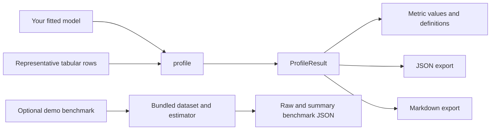

# Model Diet

**A lightweight Python library for profiling inference latency and runtime characteristics of fitted machine learning models.**

[](https://github.com/modeldiet/modeldiet/actions/workflows/ci.yml)
[](https://github.com/modeldiet/modeldiet/actions/workflows/docs.yml)
[](https://github.com/modeldiet/modeldiet/blob/master/pyproject.toml)
[](LICENSE)

Model Diet helps ML engineers inspect how an already-fitted model behaves at inference time. Give it representative tabular inputs; it returns structured measurements you can inspect or export as JSON and Markdown. It is a local profiler, not a serving benchmark or model-optimization platform.

## Install

Install the core package from production PyPI:

```bash
python -m pip install modeldiet
```

The core package supports Python 3.11 or later and depends on NumPy and psutil. It does not require scikit-learn or XGBoost; you can profile a compatible fitted model of your own without those libraries.

The copy-and-run quickstart below trains a scikit-learn model. Install the demo extra to run it:

```bash
python -m pip install "modeldiet[demo]"
```

The optional benchmark tools have separate extras:

| Install command | Includes | Use |
| --- | --- | --- |
| `python -m pip install "modeldiet[benchmark]"` | pandas and scikit-learn | Logistic Regression and Random Forest benchmark runs |
| `python -m pip install "modeldiet[benchmark-xgboost]"` | pandas, scikit-learn, and XGBoost | XGBoost benchmark runs |
| `python -m pip install "modeldiet[demo]"` | pandas, scikit-learn, and XGBoost | Demo quickstart and all benchmark types |
| `python -m pip install "modeldiet[viz]"` | Plotly | Interactive standalone HTML reports |

For development from a source checkout, see [CONTRIBUTING.md](CONTRIBUTING.md).

## Quickstart

This trains a small Random Forest, profiles it with the default latency measurement, and writes both report formats. It requires the `demo` extra. In your application, pass an already-fitted model and representative inputs compatible with its `predict()` method.

```python
from pathlib import Path

import numpy as np
from sklearn.ensemble import RandomForestClassifier

from modeldiet import profile

rng = np.random.default_rng(42)
X = rng.random((100, 5))
y = rng.integers(0, 2, size=100)

model = RandomForestClassifier(n_estimators=20, random_state=42)
model.fit(X, y)

result = profile(model=model, X=X, include_environment=True)
mean_ms = result.measurements["latency"].metrics["mean_ms"].value
print(f"Mean single-row prediction latency: {mean_ms:.3f} ms")

output_dir = Path("profile-output")
output_dir.mkdir(parents=True, exist_ok=True)
result.to_json(output_dir / "profile.json")
result.to_markdown(output_dir / "profile.md")
```

Use representative inputs with the feature layout and preprocessing your fitted model expects. This example generates data only to make the API easy to try.

## Example result

Below is an abbreviated result from one run of the quickstart above using the production wheel in a local environment. These observed latency values are machine- and workload-specific; they are illustrative only, not typical results or a performance claim. Your values will differ.

```text
model_class: RandomForestClassifier
input_type: ndarray
sample_count: 100
feature_count: 5

latency.mean    0.749 ms
latency.p50     0.795 ms
latency.p90     0.834 ms
latency.p95     0.853 ms
latency.p99     0.868 ms
latency.sample_count  100 count

environment: optional metadata included
```

Each metric also has a definition with its identifier, unit, description, and semantics. The environment field can include Python and platform details, CPU and memory information, selected library versions, and thread environment variables.

## Supported models and inputs

`profile()` accepts an already-fitted Python object with a callable `predict(X)` method. It does not require a particular estimator base class. Inputs must be non-empty two-dimensional tabular data supplied as a NumPy array, pandas DataFrame, or list or tuple of rows. Model Diet passes each row to `predict()` separately, preserving a one-row batch dimension.

## Measurements

By default, `profile()` runs only `LatencyMeasurement`: it makes one warmup prediction, then times one prediction per input row using `time.perf_counter()` without `tracemalloc` enabled.

| Measurement | Metric identifiers | Units | What the values describe |
| --- | --- | --- | --- |
| `LatencyMeasurement` | `latency.mean`, `latency.p50`, `latency.p90`, `latency.p95`, `latency.p99` | ms | Mean and percentiles of single-row prediction durations. `latency.sample_count` is a count. |
| `TracedAllocationMeasurement` | `python_traced.peak_allocation` | MiB | Peak Python-traced allocations during a separate inference pass; native allocations not tracked by `tracemalloc` are excluded. |
| `ProcessRSSMeasurement` | `process_rss.before`, `process_rss.after`, `process_rss.delta` | MiB | Whole-process RSS endpoint snapshots and their difference; not model-only memory or peak RSS. |
| `SerializationMeasurement` | `pickle.size` | MiB | Size of the model's Python pickle representation; it can differ from its deployed artifact size and does not mean pickle is safe or portable. |

You can select other strategies from `modeldiet.profiling`. Supplying `measurements=[...]` replaces the default list, so include `LatencyMeasurement()` explicitly if you want latency alongside other measurements. Each strategy makes its own pass over the input.

## Understanding the results

`profile()` returns a `ProfileResult`. Its `measurements` mapping contains `MeasurementResult` objects. Each metric provides a value and a definition:

```python
metric = result.measurements["latency"].metrics["mean_ms"]
print(metric.value)
print(metric.definition.identifier, metric.definition.unit)
```

The result also records the model class and module, input type, sample count, feature count, and schema version. Environment metadata is opt-in through `include_environment=True`. The detailed [application guide](https://modeldiet.github.io/modeldiet/application/) covers error handling, exports, and custom measurement strategies.

## Interactive HTML reports

Install the optional visualization extra. The core profiler and `import modeldiet` do not load Plotly:

```bash
python -m pip install "modeldiet[viz]"
```

The current report command consumes existing benchmark JSON files, so it does not rerun model execution. For example, after producing results with the demo benchmark workflow:

```bash
modeldiet-report results/lr.json results/rf.json --experiment "Breast cancer test set" --output report.html --include-json
```

The report is a standalone offline HTML file with interactive latency percentile, process RSS, Python-traced allocation, loading time, serialized size, and accuracy-versus-P99 charts. It includes a metric only when supplied by the source results. The core `ProfileResult` currently retains percentile summaries rather than raw latency observations, so its latency distribution panel explains that samples are unavailable instead of deriving a fake distribution. Benchmark JSON may supply actual raw observations under `latency_observations_ms` to enable the ECDF. Accuracy and loading-time comparisons are included when the benchmark JSON contains those observed values.

P50, P95, and P99 are the observed latency percentiles: half, 95%, and 99% of timed predictions completed at or below that duration. Process RSS values describe whole-process resident memory snapshots, while Python-traced allocations cover memory tracked by `tracemalloc` and exclude native allocations. They are separate measurements and should not be treated as equivalent. The accuracy-versus-P99 chart shows a trade-off between predictive performance and single-row tail latency; it does not assign a composite score or select an overall winner.

`ProfileResult.to_json()` continues to write the existing per-model JSON format. The report CLI can optionally also write a combined `results.json` beside the HTML output. The current repository has no general-purpose `modeldiet profile` CLI; use the Python `profile()` API for arbitrary fitted models and pass its results to `write_html_report()` when comparing them:

```python
from modeldiet.visualization import write_html_report

write_html_report({"Classifier A": result_a, "Classifier B": result_b}, "report.html")
```

For notebook figures and pairwise or normalized comparisons, see the
[interactive visualization guide](docs/visualization.md) and the public
`ModelDietVisualizer` API. It returns Plotly figures for use with `.show()` or
Plotly's static and HTML export methods.

For a guided newcomer experience, install the demo dependencies with
`python -m pip install -e ".[demo]"` and run `modeldiet-demo`. Choose a built-in dataset and one or more example models;
ModelDiet trains and profiles them locally, then opens one native dashboard
window without launching a browser. The dashboard includes explanations of what the metrics
measure and their limits. The demo uses small scikit-learn datasets and is
intended for exploration, not production benchmarking.

## Additional benchmark workflow

`modeldiet.profile()` measures a model you have already fitted using your own representative data. The separate `modeldiet.benchmark` tools run demonstration workflows: they load a bundled dataset, construct and train a selected estimator, then write raw run and summary JSON files. This benchmark workflow is optional and is not required to use `profile()`.

```python
from modeldiet.benchmark import run_repeated_benchmark

run_repeated_benchmark("lr", repetitions=1, output_dir="benchmark-output")
```

Use the `modeldiet[benchmark]` extra for Logistic Regression or Random Forest, and `modeldiet[benchmark-xgboost]` for XGBoost. Unlike core `profile()`, the demonstration benchmark reports accuracy because it has labels for its bundled dataset. See the [benchmark guide](https://modeldiet.github.io/modeldiet/application/#optional-benchmark-runner) for details.

## Limitations

Model Diet reports inference measurements, not deployment-wide guarantees. In particular, it does **not** measure:

- Accuracy or prediction quality in the core profiling API.
- GPU memory.
- Batch throughput: predictions are timed one row at a time.
- Concurrent-serving capacity.
- End-to-end API or network latency.
- Peak process RSS: RSS values are before-and-after snapshots.
- The deployed artifact size: the serialization measurement reports pickle representation size only.
- Built-in adapters for PyTorch, TensorFlow, or ONNX Runtime.
- Automatic model comparisons or optimization recommendations.

Results depend on the model, input data, software stack, machine, and background load. Compare runs under similar conditions and treat these measurements as local observations, not service-level guarantees.

## Documentation

- [Quickstart](https://modeldiet.github.io/modeldiet/quickstart/)
- [Application guide](https://modeldiet.github.io/modeldiet/application/)
- [Measurement definitions](https://modeldiet.github.io/modeldiet/measurements/)
- [Public API and compatibility policy](https://modeldiet.github.io/modeldiet/api/)
- [Documentation hosting and local build](https://modeldiet.github.io/modeldiet/hosting/)
- [Contributing guide](CONTRIBUTING.md)
- [Security policy](SECURITY.md)
- [Changelog](CHANGELOG.md)
- [Code of Conduct](CODE_OF_CONDUCT.md)
- [Governance](GOVERNANCE.md)

## Architecture overview



Core profiling accepts your model and input data. The demonstration benchmark is a separate optional workflow with its own bundled dataset and estimators.

## Development and contributions

To work on the project, install its test and demo dependencies from a checkout and run the tests:

```bash
python -m pip install -e ".[test,demo,dev]"
python -m pytest -v
```

See [CONTRIBUTING.md](CONTRIBUTING.md) for contributor setup and quality checks. Contributions and issue reports are welcome.

## License

Model Diet is distributed under the [MIT License](LICENSE).
